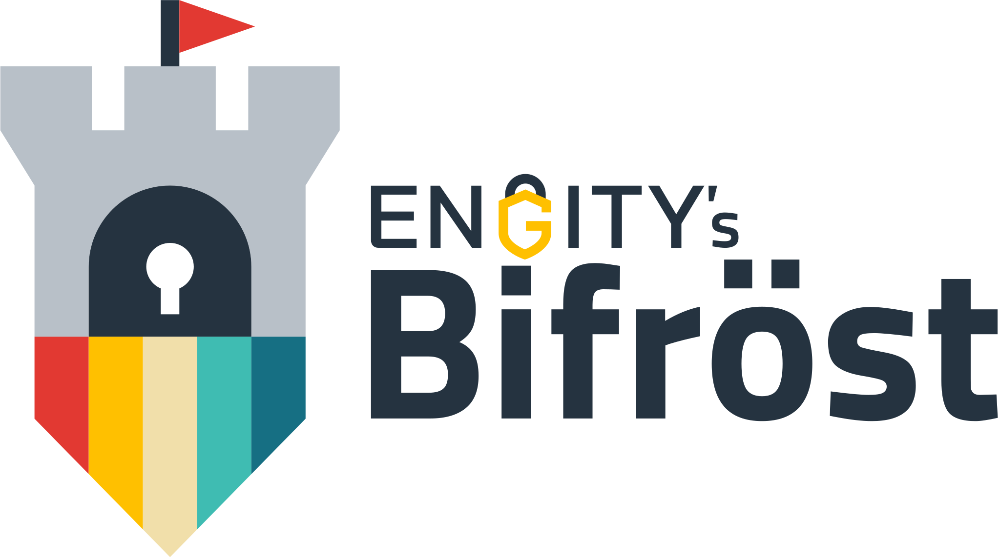

# Engity's Bifröst

Bifröst is a configurable SSH server and gateway for hosts and workspaces. Use an [IdP](https://bifroest.engity.org/reference/authorization/oidc/), [local accounts](https://bifroest.engity.org/reference/authorization/local/) or [accounts defined in YAML](https://bifroest.engity.org/reference/authorization/simple/).

**Config-first, testable, simple to deploy** — [version rules, test changes and deploy with your existing tools](https://bifroest.engity.org/concept/).

## Features

* **Standard SSH clients:** Connect using OpenSSH, PuTTY or another regular SSH client without installing a Bifröst-specific client.
* **Flexible authorization:** Combine identity sources and access rules through configurable flows.
* **Host and container sessions:** Work as a local user, in a Docker container or in a Kubernetes Pod; optionally provision and clean up managed local accounts.
* **SSH gateway:** Reach private SSH servers through a [separately authenticated connection](https://bifroest.engity.org/guides/ssh-gateway/) with target host-key verification.
* **Audit and recording:** Optionally write signed audit events and verifiable [terminal recordings](https://bifroest.engity.org/guides/recording/).
* **Time-bound access:** OIDC can close Bifröst connections after a refresh grant is rejected. Set connection and session lifetimes to support [off-boarding targets](https://bifroest.engity.org/usecases/#offboard) such as 15 or 60 minutes, and test the result against your IdP and requirements.

## Get started

[Install Bifröst on Linux, Windows or macOS](https://bifroest.engity.org/setup/on-host/) as a host service, or choose [Docker](https://bifroest.engity.org/setup/in-docker/) or [Kubernetes with Helm](https://bifroest.engity.org/setup/in-kubernetes/). Then follow a task guide:

* [OIDC login with a standard SSH client](https://bifroest.engity.org/guides/oidc/)
* [SSH gateway to an OpenSSH server](https://bifroest.engity.org/guides/ssh-gateway/)
* [Verifiable session recording](https://bifroest.engity.org/guides/recording/)

Install the CLI in a workflow with the [Setup Bifröst GitHub Action](https://bifroest.engity.org/setup/github-actions/), for example to run offline configuration tests before deployment.

Documentation links target the current stable release, which may differ from `main`. Choose a [published release](https://github.com/engity-com/bifroest/releases) and its **[matching versioned documentation](https://bifroest.engity.org/)**. Alpha and beta container images use only full version tags such as `:1.0.0-beta1`; `:latest` and other moving tags are for stable releases.

## OpenSSH migration and security

Replacing an OpenSSH `sshd`? Use the [host installation guide](https://bifroest.engity.org/setup/on-host/) to set up Bifröst, and the [configuration reference](https://bifroest.engity.org/reference/configuration/) to select your SSH access policies. For an evaluation, read [Choosing Bifröst](https://bifroest.engity.org/choosing-bifroest/), [Security and trust](https://bifroest.engity.org/security/) and the [operations and availability limits](https://bifroest.engity.org/setup/operations/). Review the [upgrade guidance](https://bifroest.engity.org/setup/upgrade/) when updating Bifröst; report vulnerabilities through the [security policy](SECURITY.md).

## Project

[License](LICENSE) | [Contributing](CONTRIBUTING.md) | [Code of Conduct](CODE_OF_CONDUCT.md) | [Report an issue](https://github.com/engity-com/bifroest/issues/new/choose) | [Discussions](https://github.com/engity-com/bifroest/discussions)
